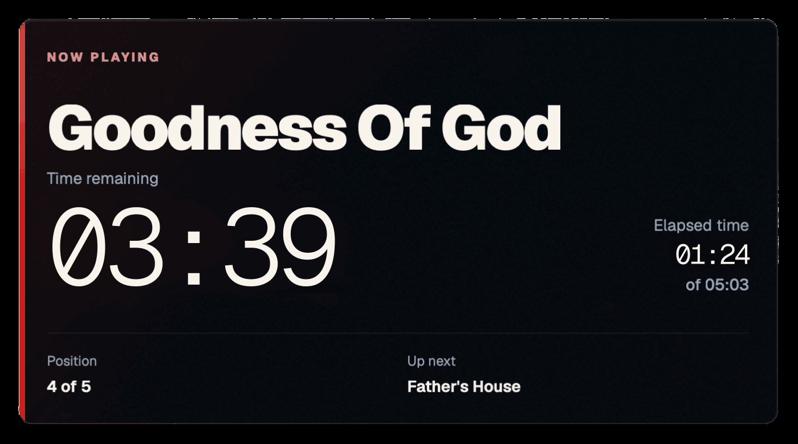
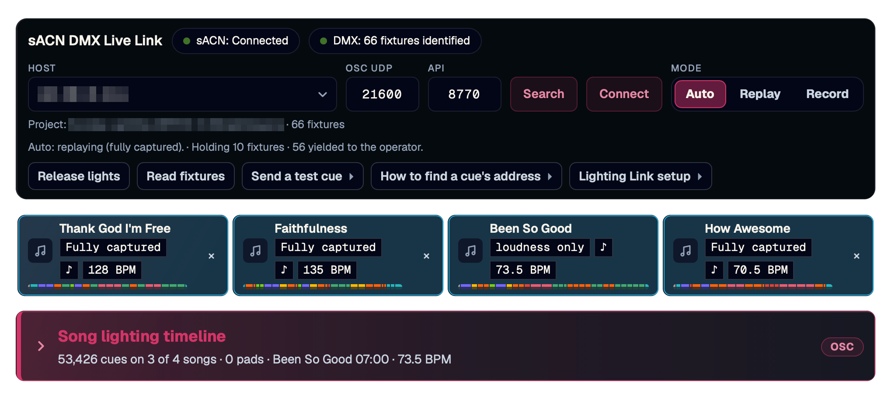

<picture>
  <source media="(prefers-color-scheme: dark)" srcset="docs/img/title-dark.png">
  
</picture>

**Your production tech stack, working as one.** StagePilot connects Planning Center, MultiTracks Playback, ProPresenter and a software lighting controller like Lightkey. Everything follows the tracks: the screens, the countdown, and the lights in sync.

### The Plan

StagePilot loads this week's service from Planning Center.

### The Tracks

StagePilot follows duration updates from Playback when approved, so everyone sees what's playing, how long is left and what's next.

### The Presentation

StagePilot keeps ProPresenter's countdown and Look current, while adding the setlist to your playlist with each song's arrangement and key.

### The Lights

Run the song with your Lightkey operator in practice and StagePilot captures then replays it with that song. If someone touches a fixture, StagePilot hands it back to be manually adjusted. OSC or MIDI cues can be arranged manually as well, synced with the song's timecode.

**Try it:** download StagePilot for Windows or Mac from the **[latest release](https://github.com/tage-ilot/stagepilot/releases/latest)**, then follow the [getting started guide](docs/getting-started.md).

[Contributing](CONTRIBUTING.md) · [GPL-3.0 license](LICENSE)
