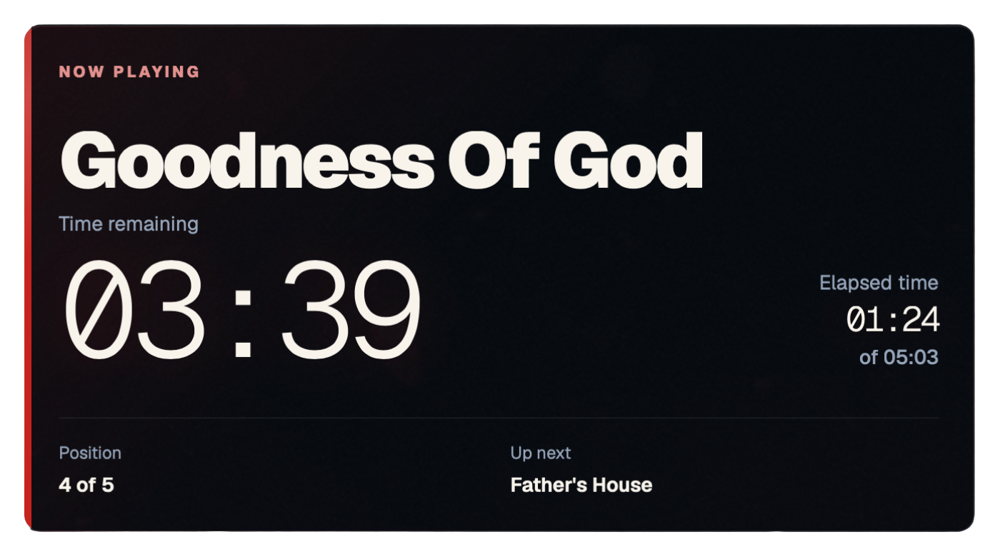
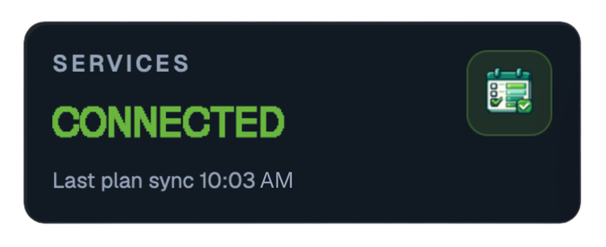
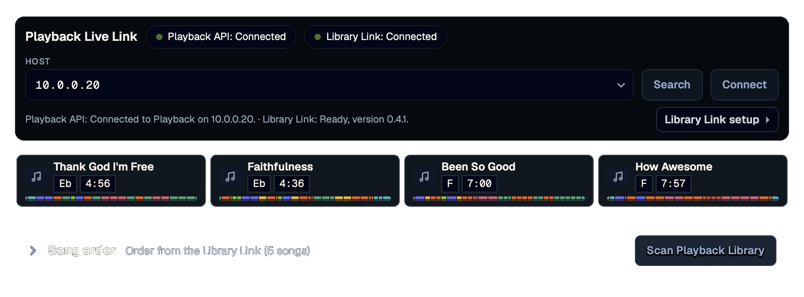
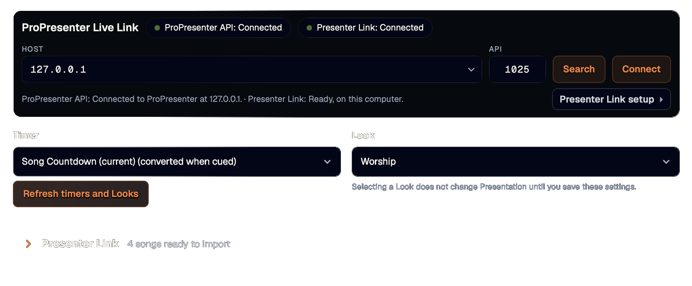

<h1>
  
  StagePilot
</h1>

**Your production tech, working as one.** StagePilot connects Planning Center, MultiTracks Playback, ProPresenter and Lightkey. Press play in Playback, and the countdown, the screens and the lights follow the song.

### The plan and the band

StagePilot loads this week's service from Planning Center and follows Playback, so everyone sees what's playing, how long is left and what's next. You can watch it on the computer or in any browser on your network.

### The screens

StagePilot keeps ProPresenter's countdown and Look in step. It also adds the setlist to your playlist with each song's arrangement and key.

### The lights

Record your operator's Lightkey run once, and StagePilot replays it with that song every week. If someone touches a fixture, StagePilot hands it back. Other lighting controllers get timed MIDI or OSC cues.

## Try it

Download StagePilot for Windows or Mac from the **[latest release](https://github.com/tage-ilot/stagepilot/releases/latest)**, then follow the [getting started guide](docs/getting-started.md).

[Contributing](CONTRIBUTING.md) · [GPL-3.0 license](LICENSE)
