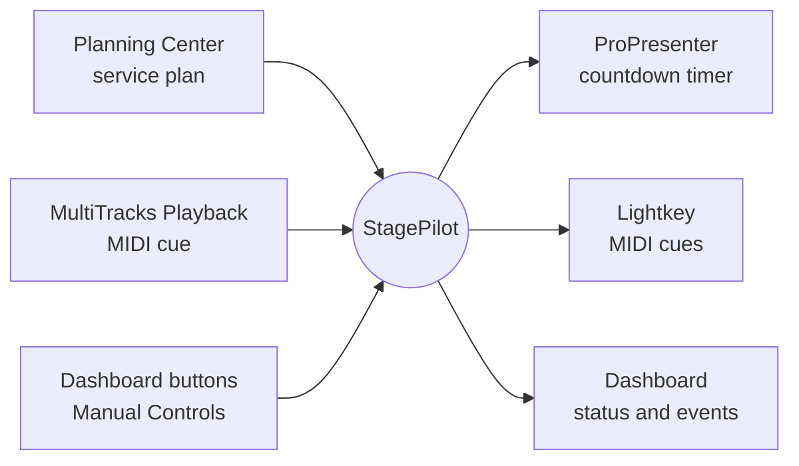
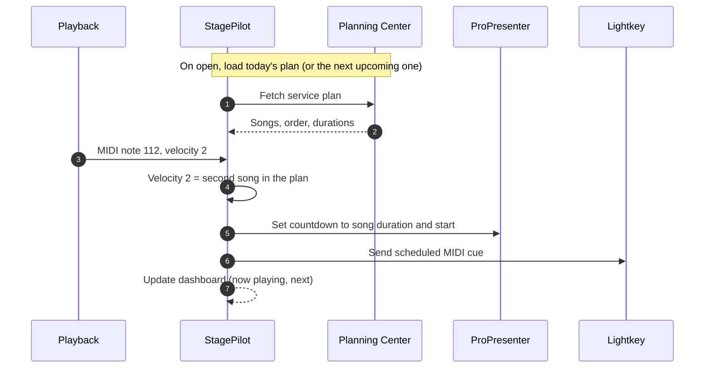
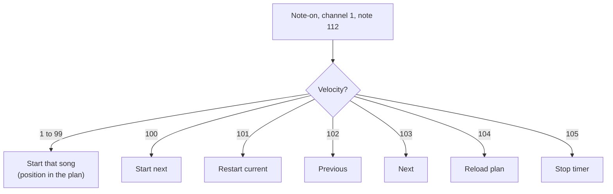
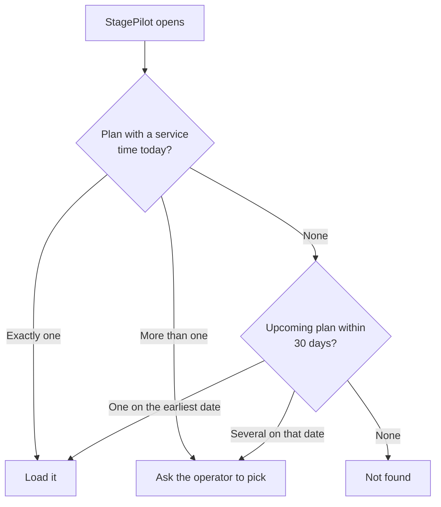
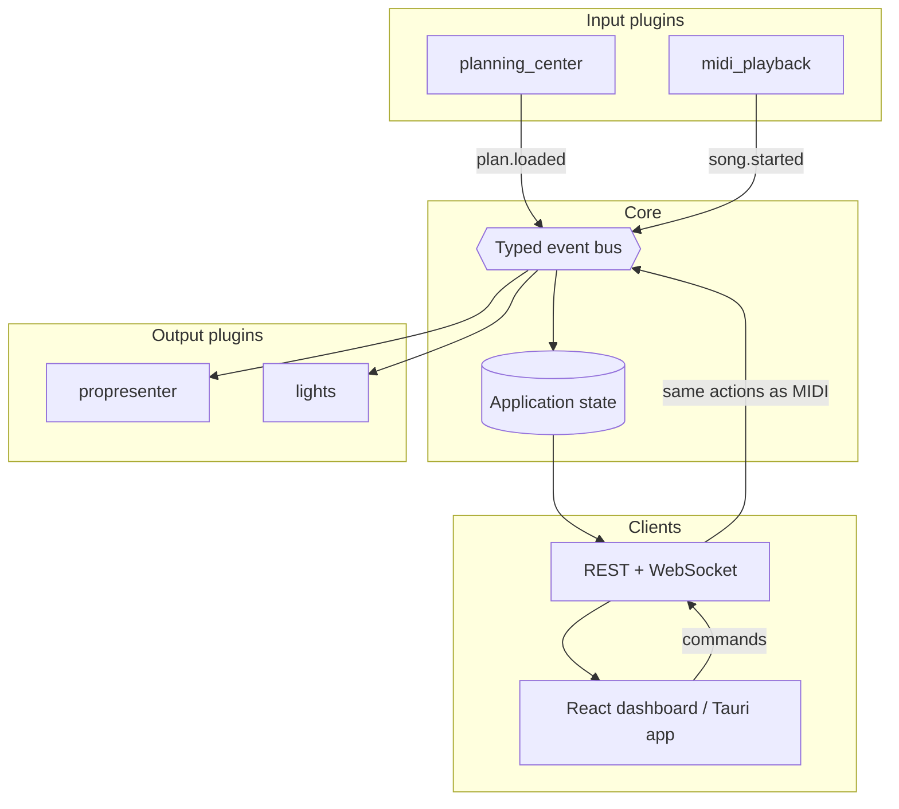
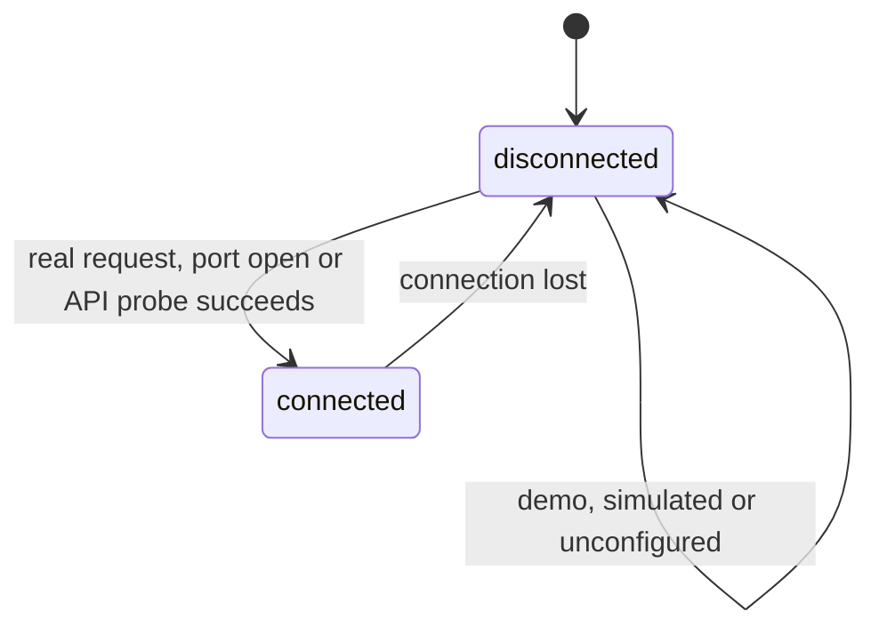

# StagePilot at a glance

StagePilot is one dashboard for the moving parts of a live service. It reads the plan, listens for cues, keeps the countdown in sync and fires lighting.

## What goes in, what comes out

Each connection is independent. You can set up and test one without the others being online.

## One song, start to finish

## Which cue does what

The default cue is MIDI channel 1, note 112. The **velocity** picks the action.

## Which service plan loads

StagePilot never picks silently between equally plausible plans.

## How the inside is wired

Inputs never call outputs directly. They publish events, and anything that cares reacts. A failure in one integration cannot take down the others.

## Connection health

"Connected" means verified, never assumed. Demo mode never reports a live connection.

## Where to read more

| I want to... | Read |
| --- | --- |
| Install and set up | [README](../README.md) |
| Write a plugin or understand the design | [plugins](plugins.md) |
| Control lighting | [lights](lights.md) |
| Lock things down | [security](security.md) |
