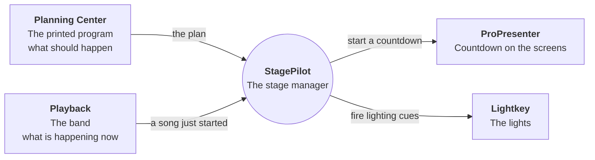
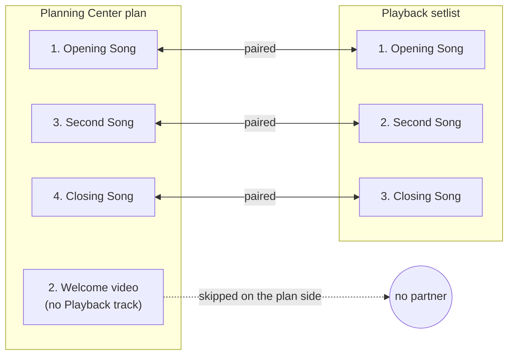
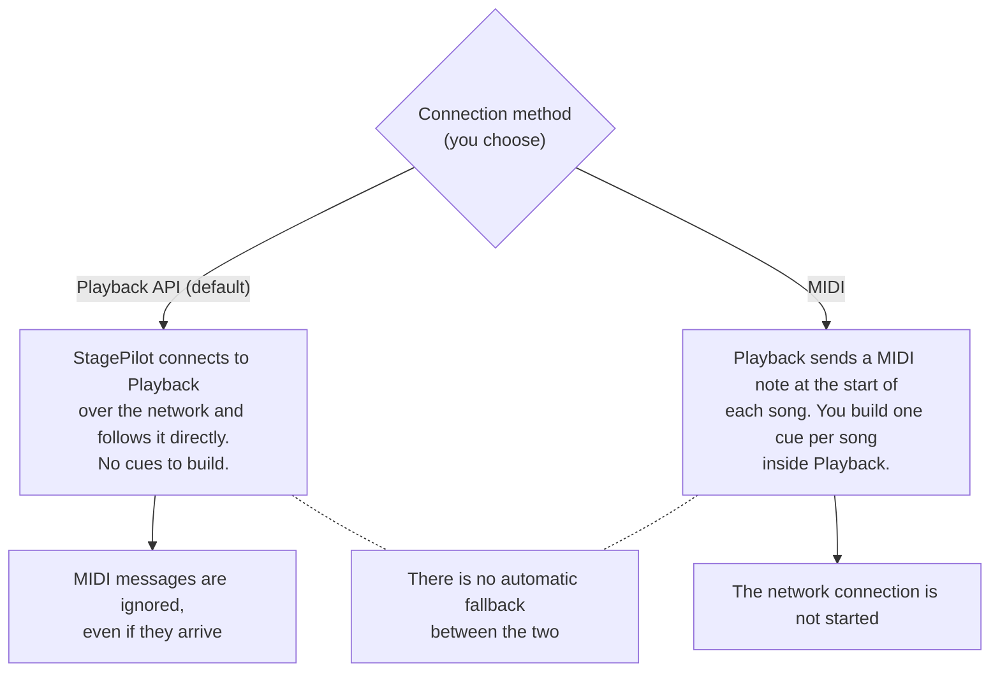
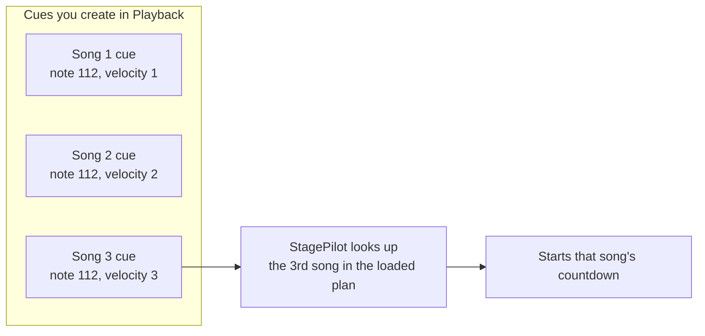
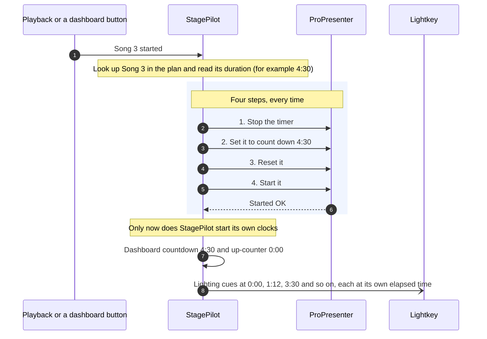
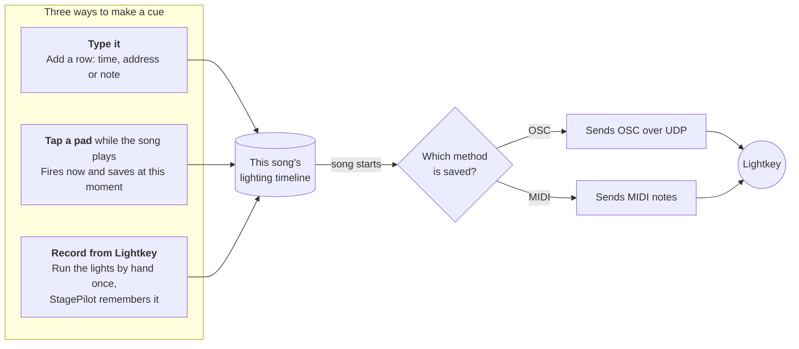
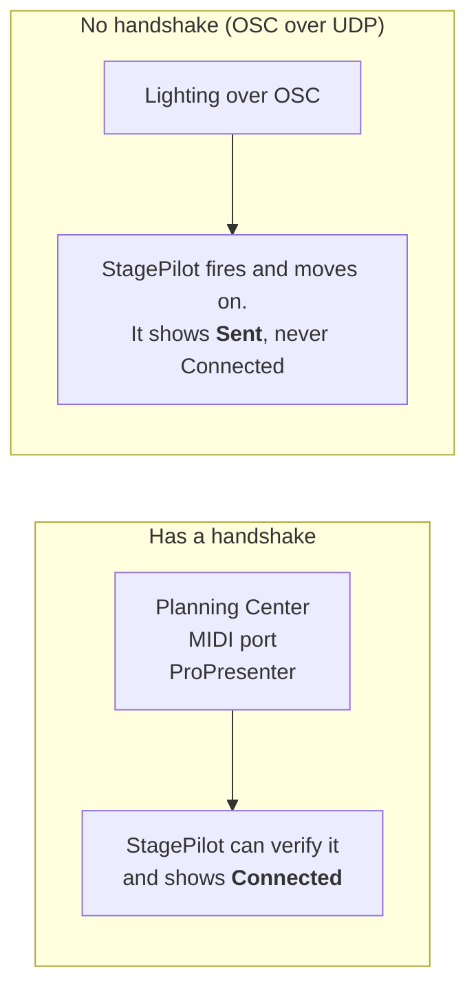
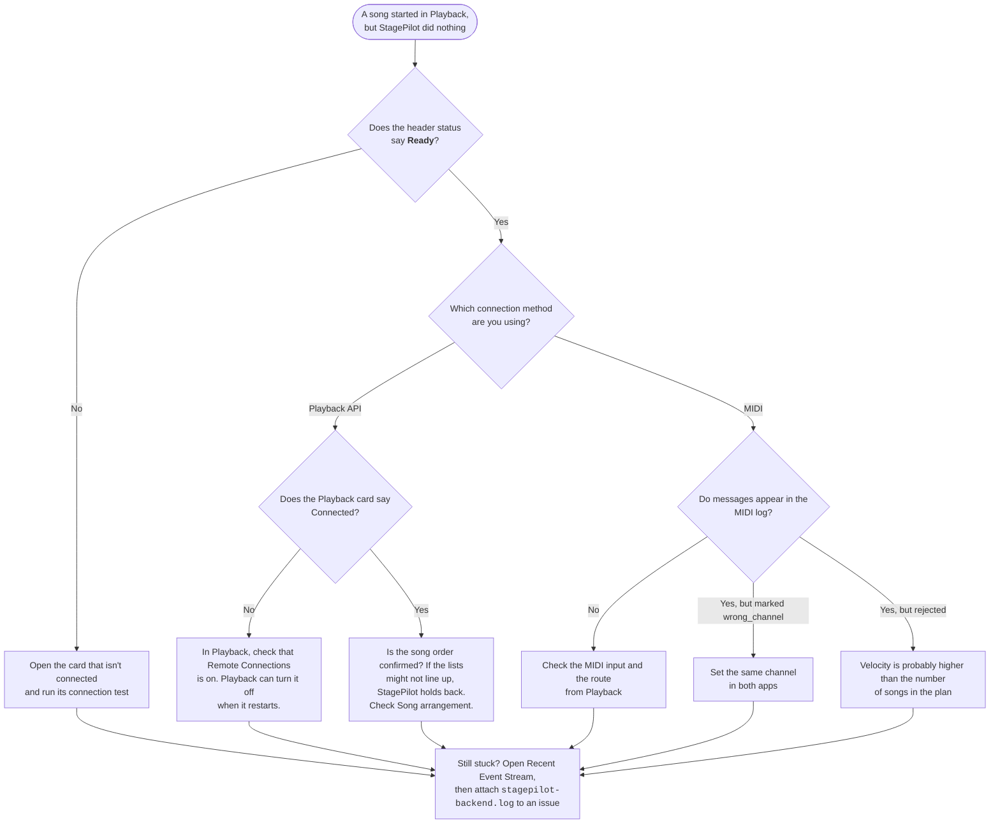

# How StagePilot thinks

Most of StagePilot is simple: connect your tools, open the dashboard, run the service. Three ideas trip people up, though. This page explains each one with a picture first and the details after. For setup steps, use the [README](../README.md).

Think of StagePilot as a **stage manager**. The printed program (Planning Center) says what is supposed to happen. The band (Playback) says what is happening right now. The stage manager matches the two, then calls the cues for the screens and the lights.

Each connection is independent. If ProPresenter is offline, the dashboard, Planning Center and lights keep working, and you can test one connection without the rest.

---

## 1. How does StagePilot know which song is playing?

Playback and Planning Center each have their own song list, and **they don't share song IDs**. StagePilot can't match "Song B" by name. It matches by **position**: the third song in one list is paired with the third song in the other.

That works until the two lists disagree. Maybe Playback doesn't have a song that is in the plan, or the plan has a spoken item between songs.

This is what **Song arrangement** in the Playback panel is for. Skip an item on either side and the rest pair up in order. Nothing is ever reordered, and skips are saved with **Save configuration**.

> [!IMPORTANT]
> If StagePilot isn't sure the two lists line up, it refuses to start a song rather than guess. Starting the wrong countdown in the middle of a service is worse than not starting one.

### Two ways to listen, and only one at a time

StagePilot can hear "a song started" in two ways. You choose with **Connection method** in the **MIDI / Playback** panel.

> [!TIP]
> If you aren't sure which to use, use the default, **Playback API**. You don't have to create any cues in Playback, and StagePilot reconnects by itself if Playback restarts.

#### In MIDI mode, the velocity is the song number

MIDI mode has one more unusual idea. Every song uses the **same note** (channel 1, note 112 by default). The **velocity** of that note says which song it is.

Velocities 1–99 are song numbers. Velocities 100–105 are reserved for actions such as Start next, Restart, Previous, Next, Reload plan and Stop timer. If you send velocity 12 and the plan only has 8 songs, StagePilot rejects it instead of starting something else.

---

## 2. What happens when a song starts?

One trigger sets three things moving: the ProPresenter countdown, StagePilot's own clocks, and the lighting timeline. They don't all start at the same instant, and the order matters.

Why four steps? ProPresenter has **one reusable timer**. StagePilot re-points it at each song instead of creating timers. Resetting first makes sure no leftover time from the previous song can show up.

### Common surprises

| What you see | What is going on |
| --- | --- |
| The lights never started, but the countdown did | Lighting only starts after ProPresenter confirms the timer started. If that confirmation didn't arrive, there's no lighting timeline. |
| A restart made the lights "jump back" | Restart cancels every remaining cue from the old timeline and creates a fresh one at 0:00. This is on purpose. |
| A lighting cue never fired | Cues set later than the song's duration are not scheduled. |
| The lights drift from the audio | The lights follow StagePilot's own clock from the confirmed start, not Playback's position in the audio. MIDI Clock isn't used because it carries tempo, not a timestamp. |
| Stop didn't clear ProPresenter's duration | Stop keeps the configured duration. **Reset Position** is the one that sets it back to 0:00. |

---

## 3. Lighting: where cues come from, and which ones fire

Lighting causes the most "wait, why?" moments. It has three ways to **make** a cue, two ways to **send** one, and a status light that doesn't mean what you'd expect.

### Making cues

Ways to think about it:

- **A pad is a reusable button.** Press it mid-song and it both fires the cue and writes it into this song's timeline at the current time, so you can program lights by playing along. Switch on **Preview only** to test pads without saving anything.
- **Record and replay** is for lighting that is more than "turn a cue on". With the optional `lightkey-api` agent running on the Lightkey Mac, StagePilot can record cues, colors, intensity and mover positions along with their timing, and play them back on later runs. Replay only touches what was recorded. Everything else stays with the Lightkey operator.

### Only one method fires, never both

> [!NOTE]
> If OSC is saved, your MIDI cues are switched off, and the other way around. Nothing is deleted. The inactive method's cues are kept and come back when you switch. Changing the method cancels any running timeline, and the new one takes effect at the next song start.

### "Sent" is not "Connected"

UDP has no reply, so StagePilot can't know whether Lightkey received a cue. It does report problems it can see, such as a host name that can't be found. So **a green "Sent" means "we sent it", not "it worked"**. Use **Send test cue** to check it end to end before the service.

---

## "Nothing happened when the song started"

Start at the top and stop when you find your problem.

---

## Go deeper

| I want to... | Read |
| --- | --- |
| Install and set up | [README](../README.md) |
| Connect Playback over the network | [Playback API](playback-api.md) |
| Set up ProPresenter and the timer | [ProPresenter](propresenter.md) |
| Set up Lightkey, pads, record and replay | [Lighting](lights.md) |
| Look up a setting or MIDI velocity | [Configuration](configuration.md) |
| Write a plugin | [Plugins](plugins.md) |
| Lock the dashboard down for the network | [Security](security.md) |
